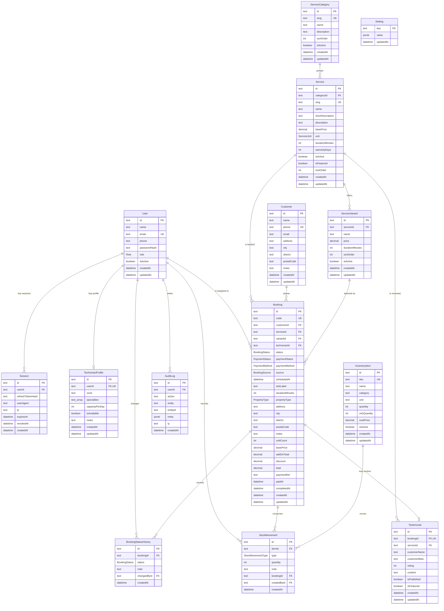

# GCC Web — Entity Relationship Diagram

The diagram and notes below mirror [`schema.sql`](./schema.sql) and
[`apps/api/prisma/schema.prisma`](../apps/api/prisma/schema.prisma). PostgreSQL
15+ is the only supported database.



## Relationship rules

| Parent | Child | Cardinality | On delete |
| --- | --- | --- | --- |
| `User` | `Session` | 1 : N | `CASCADE` |
| `User` | `TechnicianProfile` | 1 : 0..1 | `CASCADE` |
| `User` (technician) | `Booking` | 1 : N | `SET NULL` |
| `User` | `BookingStatusHistory.changedBy` | 1 : N | `SET NULL` |
| `User` | `AuditLog` | 1 : N | `SET NULL` |
| `ServiceCategory` | `Service` | 1 : N | `RESTRICT` |
| `Service` | `ServiceVariant` | 1 : N | `CASCADE` |
| `Customer` | `Booking` | 1 : N | `RESTRICT` |
| `Service` | `Booking` | 1 : N | `RESTRICT` |
| `ServiceVariant` | `Booking` | 1 : N | `SET NULL` |
| `Booking` | `BookingStatusHistory` | 1 : N | `CASCADE` |
| `Booking` | `Testimonial` | 1 : 0..1 | `SET NULL` |
| `Booking` | `StockMovement` | 1 : N | `SET NULL` |
| `Service` | `Testimonial` | 1 : N | `SET NULL` |
| `InventoryItem` | `StockMovement` | 1 : N | `CASCADE` |

Customers and catalogue rows are never hard-deleted while a booking references
them. Deactivate a service or technician instead of deleting history.

## Enum reference

| Enum | Values |
| --- | --- |
| `Role` | `ADMIN`, `TECHNICIAN` |
| `BookingStatus` | `PENDING`, `CONFIRMED`, `ASSIGNED`, `EN_ROUTE`, `IN_PROGRESS`, `COMPLETED`, `CANCELLED` |
| `PaymentStatus` | `UNPAID`, `PENDING`, `PAID`, `FAILED`, `REFUNDED` |
| `PaymentMethod` | `CASH`, `TRANSFER`, `QRIS`, `EWALLET`, `MIDTRANS` |
| `BookingSource` | `WEBSITE`, `WHATSAPP`, `PHONE` |
| `ServiceUnit` | `UNIT`, `POINT`, `PACKAGE`, `METER` |
| `PropertyType` | `RUMAH`, `APARTEMEN`, `KANTOR`, `RUKO`, `LAINNYA` |
| `StockMovementType` | `IN`, `OUT`, `ADJUSTMENT` |

## Booking state machine

```
PENDING ──► CONFIRMED ──► ASSIGNED ──► EN_ROUTE ──► IN_PROGRESS ──► COMPLETED
   │            │            │            │              │
   └────────────┴────────────┴────────────┴──────────────┴────────► CANCELLED
```

Every transition is validated by the API (`apps/api/src/lib/status.ts`) and
recorded in `BookingStatusHistory` with the acting admin, an optional note and
a timestamp. `COMPLETED` and `CANCELLED` are terminal. Cancelling a booking
frees its slot; completed bookings can no longer be reassigned.

## Money and time

- All prices are `DECIMAL(12,2)` in rupiah, computed server-side from the
  catalogue. The browser never submits a price.
- `Booking.scheduledAt` is stored as UTC. The API converts a Jakarta-local
  date plus slot id (`08:00-10:00`, `10:00-12:00`, `13:00-15:00`,
  `15:00-17:00`) with `Asia/Jakarta` rules before writing.
- `slotLabel` stores the slot id, matching `TIME_SLOTS` in
  `apps/api/src/lib/slots.ts`.
- Booking codes use `GCC-YYMMDD-XXXX` with a random four-character suffix and
  a database uniqueness check.

## Index rationale

| Index | Used by |
| --- | --- |
| `User(role, isActive)` | technician pickers and account lists |
| `Session(expiresAt)` | expired-session cleanup |
| `Service(categoryId, isActive)` | public catalogue by category |
| `Booking(status, scheduledAt)` | dashboard queue and slot counts |
| `Booking(technicianId, scheduledAt)` | daily technician workload |
| `Booking(scheduledAt)` | availability queries and today's schedule |
| `BookingStatusHistory(bookingId, createdAt)` | detail timeline in order |
| `Testimonial(isPublished, isFeatured)` | public testimonial sections |
| `StockMovement(itemId, createdAt)` | item movement history |
| `AuditLog(entity, entityId)` | tracing changes to one record |
