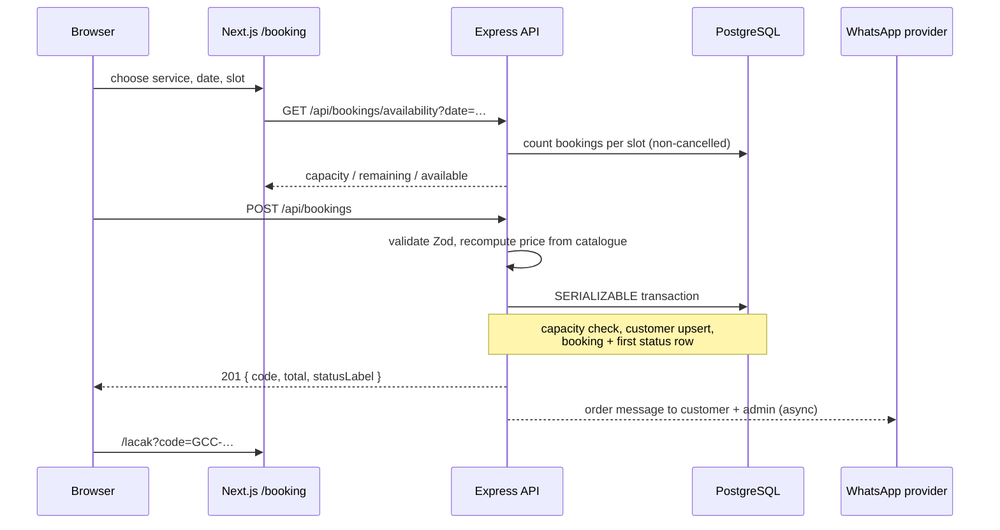

# GCC Web — Architecture

GCC Web is a two-app monorepo: a public marketing and booking site, plus a REST
API and admin panel for a home-service business. It is designed to run as a
single small deployment (one PostgreSQL database, one API process, one Next.js
process) and to be split later without rewriting the domain.

- **Business:** AC cleaning, refill, install/remove, and repair of refrigerators,
  washing machines, and TVs in Jakarta and surrounding cities.
- **Primary conversion:** a customer picks a service, a date and a two-hour
  arrival slot, and leaves a phone number. No account is required.
- **Operations:** an admin confirms the order, assigns a technician with
  capacity checks, moves the job through a fixed state machine, records payment,
  moderates reviews, and tracks stock.

## 1. Stack

| Layer | Choice | Why |
| --- | --- | --- |
| Public site | Next.js 16 App Router, React 19, TypeScript | Server-rendered marketing pages, static generation with ISR, file-based SEO metadata |
| Styling | Tailwind CSS 3.4 + design tokens in `globals.css` | Editorial ticket design; no component library to fight |
| Admin | Client-rendered routes under `/admin` | Dense operational UI, cookie session, no SEO |
| API | Express 4 + TypeScript | Small, explicit middleware pipeline; easy to host anywhere |
| ORM | Prisma 5 | Typed queries, migrations, transactions |
| Database | PostgreSQL 15+ | Enums, arrays, JSONB, serializable booking transactions |
| Validation | Zod | One schema used at the HTTP boundary and for inferred TS types |
| Auth | JWT access/refresh tokens in httpOnly cookies + hashed server sessions | Revocable sessions, short access window, rotation on refresh |
| Payments | Midtrans Snap + manual transfer/cash | Online payment optional; manual flow works without a gateway |
| Messaging | WhatsApp via Fonnte/Wablas or mock logger | Order confirmations and status updates where customers already are |

## 2. Repository layout

```
gcc-web/                       repository root
├─ apps/
│  ├─ api/
│  │  ├─ prisma/
│  │  │  ├─ schema.prisma      source of truth for the database
│  │  │  └─ seed.ts            TypeScript seed (preferred over SQL seed)
│  │  └─ src/
│  │     ├─ app.ts             Express app: helmet, CORS, JSON, cookies, routes
│  │     ├─ server.ts          listen + graceful shutdown
│  │     ├─ routes.ts          public and /admin route map
│  │     ├─ config/env.ts      Zod-validated environment, fails fast
│  │     ├─ middleware/        auth, role guard, validation, errors, rate limits
│  │     ├─ integrations/      WhatsApp and Midtrans adapters
│  │     ├─ lib/               codes, pricing, slots, status machine, audit, JWT
│  │     └─ modules/           auth, bookings, services, technicians,
│  │                           testimonials, inventory, dashboard, settings,
│  │                           payments
│  └─ web/
│     ├─ app/
│     │  ├─ (site)/            public routes with Header/Footer
│     │  ├─ admin/             login + guarded dashboard routes
│     │  ├─ sitemap.ts robots.ts manifest.ts opengraph-image.tsx
│     │  └─ layout.tsx         fonts, metadata, JSON-LD
│     ├─ components/           site, booking, admin, ui
│     └─ lib/                  API client, content loaders, demo data, types,
│                              formatting, site constants
├─ database/
│  ├─ schema.sql               PostgreSQL DDL mirroring Prisma
│  ├─ seed.sql                 runnable SQL sample data
│  └─ ERD.md                   Mermaid ERD and relationship rules
├─ docs/                       architecture, API, SEO, deployment, integrations
├─ .env.example                copy blocks into each app
└─ package.json                npm workspaces
```

Packages are `@gcc/web` and `@gcc/api`; root scripts use npm workspaces.
There is no shared package: the frontend keeps its own serialisable types so it
can be built and deployed independently of Prisma.

## 3. Request paths

### Public booking



The browser sends `serviceId`, optional `variantId`, `scheduledDate`, `slot`,
`propertyType`, `unitCount`, notes, and a `customer` object. It never sends a
price. `calculateBookingTotal()` reads the active variant (or service base
price) from the database and multiplies by `unitCount`.

Booking creation uses `Prisma.TransactionIsolationLevel.Serializable` with up
to three retries on `P2034`. Capacity is checked inside the transaction so two
customers cannot take the last seat at the same time. `SLOT_CAPACITY` defaults
to 3 bookings per two-hour slot.

### Admin operation

```
Browser /admin (client) ──cookie gcc_access──► Express requireAuth
                                              └► requireRole('ADMIN')
                                                 └► module controller
                                                    └► Prisma
```

The admin routes are client components. `app/admin/(dashboard)/layout.tsx`
calls `GET /api/auth/me`; if it fails, it redirects to `/admin/login`. The API
still enforces authentication and role on every admin route, so hiding the UI
is never the security boundary.

Mutating an order goes through the server state machine. The client only shows
the same `ALLOWED_TRANSITIONS` map to make invalid actions unavailable early.

## 4. Authentication and sessions

- Login accepts email and password; bcrypt cost factor 12.
- A login creates a `Session` row with a random UUID (`sid`), stores
  `hashToken(refreshToken)`, the user agent and IP, and an expiry.
- Two httpOnly cookies are set: `gcc_access` (default 15 minutes) and
  `gcc_refresh` (default 7 days). Both are `SameSite=Lax` in development and
  `SameSite=None; Secure` in production. `COOKIE_DOMAIN` can be set when the
  web and API are on sibling subdomains.
- Access tokens are accepted from the cookie or an `Authorization: Bearer`
  header, which helps Postman and future native clients.
- `POST /api/auth/refresh` rotates the refresh token and its hash. Reuse of an
  old token revokes every active session for that user (theft response). The web
  API client calls it once on a `401`, shares that refresh across concurrent
  requests, and retries the original call.
- Logout revokes the current session and clears both cookies.
- Deactivating a technician, or changing their password, revokes their
  sessions. A technician cannot access `/api/admin/*`.
- Rate limits: 8 login attempts per IP per 15 minutes (successful logins are
  not counted), 10 booking creations per IP per hour, 20 tracking lookups per
  15 minutes.

Production boot refuses JWT secrets containing `dev-` or `change-me`.

## 5. Booking domain rules

### Slots

Four arrival windows exist, in `Asia/Jakarta`: `08:00-10:00`, `10:00-12:00`,
`13:00-15:00`, `15:00-17:00`. Booking is allowed from today through 60 days
ahead. A slot on today’s date becomes unavailable once its start time has
passed. Times are stored in UTC; all grouping and display convert back to
Jakarta.

### Status machine

```
PENDING ──► CONFIRMED ──► ASSIGNED ──► EN_ROUTE ──► IN_PROGRESS ──► COMPLETED
   └───────────┴────────────┴────────────┴──────────────┴────────► CANCELLED
```

`ASSIGNED`, `EN_ROUTE`, `IN_PROGRESS`, and `COMPLETED` require a technician.
`COMPLETED` sets `completedAt`; terminal states cannot transition again. Every
transition adds a `BookingStatusHistory` row and an `AuditLog` entry.

### Assignment

`PATCH /api/admin/bookings/:id/assign` validates that the technician is active,
has a profile, and is marked available. It then checks:

1. daily workload against `capacityPerDay`, excluding this booking;
2. no other active booking for the same technician in the same slot;
3. the booking is not completed/cancelled, en route, or already in progress.

Assigning a `PENDING` or `CONFIRMED` order moves it to `ASSIGNED` and writes the
history row in the same transaction.

### Payment

Payment status is separate from job status. Manual payment can be set to
`UNPAID`, `PENDING`, `PAID`, `FAILED`, or `REFUNDED`; paying requires a method.
Refunds are only allowed from `PAID`. Marking paid sets `paidAt`, sends a
WhatsApp receipt, and records an audit entry. Midtrans notifications verify the
SHA-512 signature and compare `gross_amount` with the stored total before
updating anything.

## 6. Data access and graceful fallbacks

The public site uses `apps/web/lib/content.ts`:

- If `NEXT_PUBLIC_DEMO_MODE=1`, catalogue, testimonials and settings come from
  `lib/demo-data.ts`.
- Otherwise it calls the API with `next: { revalidate: 300 }` and a 2.5-second
  timeout. If the API is unavailable, it falls back to the same demo content.

This keeps the marketing site up during an API restart and makes local design
work possible without a database. The trade-off is that fallback content is not
labelled on public pages; the admin surface does label demo/fallback data
explicitly. For launch, set `NEXT_PUBLIC_DEMO_MODE=0` and run the API.

Public pages are statically generated with ISR every 300 seconds. The booking
page is dynamic because availability is time-sensitive; admin pages are
client-rendered.

Admin list pages also fall back to demo data when an API call fails, but they
show a `SourceNotice` and disable destructive assumptions with a visible
`DemoActionNote`. This is deliberate for design review, not a production
feature: an outage should be visible to the operator.

## 7. API conventions

- Base path `/api`.
- Success: `{ "success": true, "data": … }`.
- Paginated: adds `meta: { page, limit, total, totalPages }`.
- Failure: `{ "success": false, "error": { code, message, details? } }`.
- Validation failures return `422 VALIDATION_ERROR` with a `details` array of
  `{ path, message }`.
- HTTP status carries the class of error: `400`, `401`, `403`, `404`, `409`,
  `422`, `429`, `500`, `502`, `503`.
- All input is validated and trimmed with Zod. Body size is capped at 100 kB.
- Money in booking and dashboard responses is a JSON number. Prisma `Decimal`
  in catalogue and inventory admin responses serialises as a string; the web
  client normalises it with `Number()` before formatting.
- Dates are ISO-8601 UTC strings in JSON. Jakarta dates are `YYYY-MM-DD`.

The full route list and payloads are in [`API.md`](./API.md).

## 8. Security posture

| Concern | Control |
| --- | --- |
| Password storage | bcrypt cost 12, never returned by the API |
| Session theft | hashed refresh token in DB, rotation, reuse revokes all sessions |
| XSS | React escaping, no `dangerouslySetInnerHTML` except JSON-LD built from constants |
| CSRF | cookies are `SameSite=Lax/None`; admin writes require JSON and the CORS allowlist. For a stronger posture, add a double-submit CSRF token when the admin is exposed to untrusted subdomains |
| Brute force | per-IP login limiter; generic “email or password wrong” response |
| Enumeration | tracking and testimonial submission return the same not-found message when the phone does not match |
| Headers | `helmet()` on the API; `X-Content-Type-Options`, `Referrer-Policy`, `X-Frame-Options`, `Permissions-Policy` on Next.js |
| CORS | only `WEB_ORIGIN`, `localhost:3000`, and `127.0.0.1:3000`, with credentials |
| Admin indexing | `/admin` metadata `noindex`, `robots.txt` disallow, no links from public pages |
| Customer data | only name, phone, optional email, address, notes; no payment card data ever reaches the server |
| Audit | admin status, assignment, payment, inventory and settings changes recorded in `AuditLog` |
| Secrets | `.env` ignored; only `.env.example` committed |
| Input size | 100 kB JSON/urlencoded limit; field-level max lengths in Zod |
| SQL injection | Prisma parameterised queries; raw SQL only for `SELECT 1` health check |

Known gaps to close before a public launch:

- Add a Content-Security-Policy (needs the final font/image/script origins).
- Add email verification or a second factor for admin accounts.
- Put the admin behind a network allowlist or SSO if the team grows.
- Add a scheduled job to delete expired sessions and old audit logs.
- Back up the database and test restore; customer history is the business.

## 9. Design system

The visual language is an **editorial service ticket**: bone paper, deep ink,
teal for action, rust and amber for warnings, square corners, hairline rules,
numbered sections, ticket notches, and monospaced codes. Type is Plus Jakarta
Sans with display sizes set in fluid `clamp()` tokens. There are no gradients,
glass panels, rounded “SaaS cards”, or generic icon grids.

Key tokens live in `apps/web/app/globals.css` and `tailwind.config.ts`:

| Token | Value | Role |
| --- | --- | --- |
| `bone` | `#F4F1EA` | page ground |
| `paper` | `#FBFAF6` | raised content |
| `surface` | `#EAE6DD` | secondary field |
| `ink` | `#101B17` | text and dark panels |
| `muted` | `#5B625D` | secondary text |
| `line` | `#CFC7B8` | rules and borders |
| `teal` | `#0B5D4F` | primary action |
| `teal-soft` | `#DCE7E2` | selected / positive field |
| `field` | `#0E1F1A` | dark form ground |
| `rust` | `#9B4A2B` | destructive / error |
| `amber` | `#A9741C` | warning / pending |

Accessibility: skip link, semantic landmarks, visible focus rings, labelled
forms, error text paired with `role="alert"`, status updates with
`role="status"`, reduced-motion handling, and 44 px minimum touch targets on
primary actions.

## 10. Observability and operations

- `morgan` request logs (`dev` locally, `combined` in production).
- `GET /api/health` checks `SELECT 1` and returns `503 NOT_READY` if the
  database is down.
- `server.ts` handles `SIGTERM`/`SIGINT`, stops accepting connections, and
  disconnects Prisma.
- Audit entries are written for operator-visible mutations.
- `trust proxy` is enabled; deploy behind a proxy that sets `X-Forwarded-For`
  and terminate TLS there.
- There is no metrics/tracing exporter yet. Add one at the reverse proxy or
  instrument with OpenTelemetry before scaling.

## 11. Scaling notes

The current design handles a city-scale service business comfortably. When
load grows:

1. Run multiple API instances behind a load balancer; sessions are in
   PostgreSQL, so no sticky sessions are required.
2. Move rate limiting to Redis (`rate-limit-redis`) so limits are shared.
3. Add read replicas for catalogue and reporting; keep booking writes on the
   primary.
4. Move WhatsApp sends to a queue (BullMQ/SQS) with retries; today they are
   fire-and-forget after the response.
5. Add a materialised daily revenue/workload view if the dashboard queries grow.
6. Cache the public catalogue at the CDN edge and invalidate on service change
   instead of relying only on 300-second ISR.

The domain model does not need to change for any of these steps.
